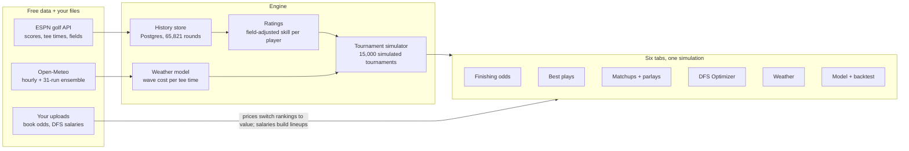

# golfprob — PGA Tour Engine Build Readout

*As of 2026-10-24 · Live doc: https://claude.ai/artifact/YNpS9T1BkUaMVMBDjM4CQo · Repo: [Haywood1033/golfprob](https://github.com/Haywood1033/golfprob) (`main`)*

golfprob is a live PGA Tour betting and DFS engine at [golfprob.vercel.app](https://golfprob.vercel.app): one Monte Carlo tournament simulator (15,000 runs) feeds finishing odds, 2-ball/3-ball matchups, parlays, a DFS lineup optimizer and a best-plays board, on 66k free-data rounds, with 35 automated tests.

## Architecture at a glance

History and weather feed one simulator; every tab reads its runs, and your uploaded prices and salaries only change how plays are ranked and lineups built.

## What it does

Six tabs, all reading the same simulation, so no two numbers on the site can contradict each other.

| Tab | The question it answers | What's on it |
| --- | --- | --- |
| Finishing odds | Who finishes where? | Win / Top 5 / 10 / 20 / Make cut, fair odds, avg finish, live position (pos, to par, thru), AM/PM draw with weather cost, signals, confidence; click a player for finish distribution, last 24 rounds, tee times and reasons |
| Best plays | What should I bet? | Matchup targets, finishing-position targets per market, best 3/4/5-leg finishing parlays; per-play reasons and a section summary of why they stand out; value ranking when book prices are loaded |
| Matchups | Who wins each group? | Every 2-ball and 3-ball from the real tee sheet, a win-share bar per group, book-odds upload with de-vigged edges and value badges, a parlay builder priced inside the sim, auto-build |
| DFS Optimizer | What lineups do I play? | Classic golf scoring projections (mean, floor, ceiling), salary CSV upload, exact 6-golfer / $50k optimizer for 1–150 lineups with exposure, uniqueness, locks, excludes and draw stacking; exposure table; upload-ready CSV |
| Weather | Which half of the draw is favored? | Draw verdict with forecast-ensemble agreement, day cards, hourly wind/gust chart with ensemble band and wave ribbons, direction strip, wind-by-wave compass, rain and temperature, wave table, a generated written briefing |
| Model & backtest | Can I trust it? | History status, the live track record (locked pre-tournament projections graded weekly), and a leak-free backtest with Brier, log loss, calibration chart and per-event results |

## How the model works

One model predicts a single round score per player; a simulator plays the tournament out 15,000 times; every market is counted from those runs.

1. **History.** Every completed round from ESPN's free API for the PGA Tour, LIV and DP World Tour, stored in Postgres: 65,821 rounds, 1,738 players, Nov 2024–Oct 2026. Team and points-scored events are excluded.
2. **Field-strength adjustment.** A two-way fixed-effects fit (strokes = round difficulty + player ability, alternating least squares), so a 68 against a weak field is not worth a 68 at a major. Players who cross tours put all three tours on one scale.
3. **Projection.** Recency-weighted mean of adjusted rounds (0.975 per round plus a one-year half-life), regressed toward a below-average prior (k = 5 rounds); per-player variance regressed to 2.8 strokes; course history regressed hard (k = 16, capped at ±0.8).
4. **Simulation.** Per-week form, per-round noise, shared wave shocks, the cut (rule from ESPN, then event name, then field size), whole-stroke scores so ties, dead heats and pushes happen naturally, playoffs. Finished rounds use real scores; a round in progress projects only the holes left, from the course's hole pars.
5. **Weather.** Open-Meteo hourly forecast plus the 31-member GFS ensemble. Each tee time's cost averages about 5 hours of wind, gusts and rain; each simulation draws one ensemble member, so forecast uncertainty flows into the odds. Weekend tee order follows each simulated leaderboard.
6. **Markets.** Top-N is dead-heat adjusted the way books settle. 3-balls split ties; 2-ball ties push. Parlays are counted per simulated tournament, not multiplied, which catches shared-wave correlation and Top-20 legs competing for the same 20 spots.
7. **DFS.** Each simulated round score becomes expected hole points over the real hole pars (tour-average par-3/4/5 outcome rates tilted to match the score, exact bogey-free and birdie-streak probabilities), plus finish points from the same run.

## Data and live verification

All data is free and keyless: ESPN's unofficial golf API (fields, scores, tee times) and Open-Meteo (forecast, ensemble, archive). Neither was reachable from the build sandbox, so the parser read every field through fallbacks and shipped with `/api/health`, which reports what actually resolved on the live deployment. Each fix below came from real responses, not guesses.

| What the live data showed | What would have gone wrong | Fix |
| --- | --- | --- |
| The event's round number lagged (1 while the field was on R2) | Every finished round read as unfinished; Thursday's scores ignored | Completion follows each player's own round and thru |
| No hole-by-hole scores on the leaderboard endpoint | Live rounds couldn't be projected | Rebuilt from hole pars + start hole + thru + today's to-par |
| Only the current round carries a start hole | Same-time groups off the 1st and 10th merged into six-player "groups" | R1 start hole inferred from R2 (tees swap) |
| `cutCount` is the number who made it (73), not the rule (65 & ties) | Backtests simulated a top-73 cut | Only standard rule sizes trusted, pre-cut only |
| Zurich Classic winner "Unknown" | Team best-ball scores fed individual ratings | Team events excluded and purged (450 rounds) |
| Barracuda uses Stableford points | Points could be stored as fake strokes | Points/match formats excluded via `scoringSystem` and name |
| THE PLAYERS stored 391 rounds, not ~430 | Looked like dropped rounds | Audit endpoint proved it correct: a 123-player field |
| Backtest kept showing April–June after the backfill | Stale accuracy read | CDN caching removed from backtests |

## Accuracy so far

On real 2026 PGA Tour events, rebuilt blind from only the rounds before each one, the model beats a no-skill baseline in every market, most clearly in Top 20 and make cut.

| Market | Skill score, Apr–Jun (8 events) | Skill score, Jul–Oct (10 events, full history) |
| --- | --- | --- |
| Win | −0.1% | +1.8% |
| Top 10 | +5.0% | +7.6% |
| Top 20 | +8.5% | +9.4% |
| Make cut | +7.0% | +8.7% |

Skill score = 1 − model Brier ÷ no-skill Brier (every player gets the market's base rate). Calibration lands near the diagonal in 20 of 22 bins. The one repeat miss is overconfidence at 50–70% for Top 20 (57% predicted vs 41–43% actual on 45 players); that is within noise, so it is being watched in live grades rather than tuned. Backtests do not apply weather yet. The live track record starts with the first event whose pre-tournament projection was locked.

## Why it looks clean

The palette, type scale and spacing were decided once, before the first tab, and every feature reuses them. nflprob and the MLB engine had to be rebuilt for looks; this one was designed for readability from the first commit.

- **One token set.** Navy background (#0a0e1a), three surface steps, two line weights, three ink levels, one brand accent (teal), and four status tones (positive, negative, warning, info) used only for meaning, always with a sign or a label.
- **Readable type.** Inter at a 14px base, nothing under 12px, tabular numbers in every column, solid 1px borders. Tiny monospace labels and 0.5px hairlines were dropped.
- **Charts by rule.** Validated colorblind-safe series colors (blue, orange, aqua, violet) that never color text; one y-axis per chart; 2px lines; rounded bar ends; hover tooltips on every chart; a legend wherever there are 2+ series.
- **Color follows the entity, not the rank.** In matchups each player keeps the color of their tee-sheet slot; the group's win-share bar always adds to 100%.
- **Every number has its why.** Signals, reasons and summaries are generated from the same figures the tables show, so the text can't drift from the data.
- **Three states, three looks.** Real model output, a stated fallback ("typical tee times", "default cut rule", "model ranking, not value") and a thin-sample warning are visibly different.
- **Honest shortfall.** When the rules can't fill a request (lineups, parlays, value plays), the page says how many qualified and why, instead of padding.
- **Phone-ready.** A 16px gutter, no sideways page scroll, sticky player columns in wide tables, and controls that wrap with their labels.

## Engineering discipline

Every "optimal" or "exact" claim on the site is checked against brute force; 35 automated tests run on synthetic data with known answers plus an end-to-end run of every route.

- **Ground truth.** The fixed-effects fit recovers true skill (correlation > 0.97) on a synthetic world built to fool naive field averages.
- **No leakage.** A test injects future rounds and proves the projection doesn't move; backtests rebuild each event from rounds dated before it.
- **Brute-force checks.** The lineup knapsack matches exhaustive search on 200 random pools; multi-lineup builds match brute force under uniqueness rules; dominance pruning never changes the optimum; 3-ball prices match a direct count of the stored simulations.
- **Internal consistency.** Exactly one winner per simulation; dead-heat Top-10 shares sum to 10; finishing-parlay legs settle identically to the simulator.
- **Guardrails against noise.** Value plays need 3%+ EV and a realistic chance (3%+, 1% for Win); parlay legs need 10%+ and +EV on their own; tickets must cash 2–5% of the time. Added after a test showed a 0.2% longshot posting a fake +$108 EV.
- **Real-browser runs.** Each feature was driven in headless Chromium against the real API handlers and checked from screenshots at desktop and phone widths, with zero console errors.
- **Defensive data layer.** Field fallbacks, a shape-report health check, a per-event parse audit, and team/points-event exclusion.

## The working process

The build followed the nflprob lessons doc (*Building a Sports Prop Engine*) as its spec, and every step was confirmed on real data before the next.

1. **Proposal first.** Read the lessons doc, proposed the architecture and data options, and got four decisions from the owner (new repo, free ESPN data, upload-your-own odds, steps 1–6 first) before writing code.
2. **Core before features.** History, ratings, simulator and weather were tested on synthetic ground truth, then the UI was built and reviewed from screenshots.
3. **Verify on the live deployment.** `/api/health` and the per-event audit turned unknown API shapes into concrete fixes; nothing was declared working from the sandbox alone.
4. **Backfill, then measure.** Two seasons across three tours, then blind backtests to read accuracy before adding betting features.
5. **Features on the same engine.** Parlays, DFS, grading and best plays all reuse the stored simulations rather than adding new models.
6. **Owner-led UI iteration.** Position column, tab rename (no DFS-site names), and win-share bars replacing an ambiguous indicator; each was explained, proposed, approved, then shipped.
7. **Say what isn't proven.** Model rankings are labeled as not value, defaults are labeled as defaults, and heuristics (weather cost, DFS hole rates) are named as such in the app.

## Known limits and what's next

The engine is complete and live; the open items are calibration work that needs more real weeks, not missing features.

- **Weather cost is a heuristic** (cost grows with wind squared, plus gusts above 25 mph and heavy rain). Next: fit it to stored wave splits once a season of tee times is in the database.
- **DFS hole rates are tour averages.** Next: fit par-3/4/5 outcome rates per course from ESPN's hole-by-hole endpoint.
- **Backtests skip weather** (no stored tee times for past events).
- **The live track record is empty until the first locked event finishes.** The site must be opened once before each round 1 to lock that week's projection.
- **Top-20 overconfidence at 50–70%** is being watched in live grades before any recalibration.
- **Optimizer code is publicly readable** because it runs in the browser (no secrets in it).

**Stack:** Vercel serverless functions + Supabase Postgres + one vanilla-JS `app.html` with no build step; `lib/` holds every model and fetcher, `api/` routes stay thin. Repo: [Haywood1033/golfprob](https://github.com/Haywood1033/golfprob) (public), branch `main`. Key files: `lib/simulator.js`, `lib/ratings.js`, `lib/weather.js`, `lib/parlay.js`, `lib/plays.js`, `lib/dk.js`, `lib/dk-optimizer.js`, `app.html`.
